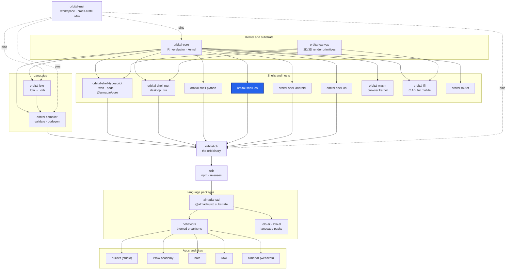

<div align="center">

# orbital-shell-ios

**The native iOS shell: generates an Xcode project (SwiftUI) from a compiled Orbital program.**

[](https://github.com/almadar-io/orbital-shell-ios/actions/workflows/ci.yml) [](LICENSE)

</div>

The iOS shell turns a compiled Orbital program into a SwiftUI app project. It carries the iOS project template and the generated SwiftUI renderer pack, and links the Almadar kernel and canvas as a static library.

## Where this fits



| Upstream (this repo depends on) | Downstream (depends on this repo) |
|---|---|
| [orbital-core](https://github.com/almadar-io/orbital-core): IR, evaluator and kernel (`orbital-core-base`, `orbital-core-eval`) | [orbital-cli](https://github.com/almadar-io/orbital-cli): the `orb` binary, which runs this shell as `orb-shell-ios` for `orb compile --shell ios` |
| [orbital-canvas](https://github.com/almadar-io/orbital-canvas): 2D/3D render primitives |  |
| [orbital-ffi](https://github.com/almadar-io/orbital-ffi): the C ABI library the generated app links (dev-dependency here) |  |

## Quick start

Build the kernel library once, from the `orbital-rust` workspace, then generate and build the app:

```bash
make ios-lib            # in orbital-rust: builds liborbital_ffi.a for aarch64-apple-ios-sim
orb compile <program.orb> --shell ios -o <out-dir>
cd <out-dir> && CARGO_BUILD_DIR=<orbital-rust>/target ./orb-build.sh
```

`make ios-lib-device` builds the device library (`aarch64-apple-ios`). In `orbital-rust`, `make ios-run ORB=<program.orb> OUT=<dir>` runs the compile and `orb-build.sh --run` together.

## How `orb compile --shell ios` uses it

`orb` runs the `orb-shell-ios` program. It needs the resolved program and the installed `swiftui` renderer pack, copies `templates/ios-shell` (`project.yml`, `Info.plist`, `Sources/`, `orb-build.sh`), and generates the Swift sources; it then validates the project structure and layout. The next step it reports is `./orb-build.sh`.

The generated app runs the same kernel as every other host, through `orbital-ffi`: `orb-build.sh` requires `CARGO_BUILD_DIR` to point at the Cargo target directory holding `aarch64-apple-ios-sim/release/liborbital_ffi.a`, which `make ios-lib` in `orbital-rust` produces (and checks for the kernel and canvas symbols).

## Layout

| Path | Contents |
|---|---|
| `src/` | The crate: backend, pack, shell, `orb-shell-ios` program |
| `templates/ios-shell/` | Xcode project scaffold |
| `renderers/swiftui/` | Generated SwiftUI renderer sources and pattern fixtures. Generated: fix the template or generator, not the output |
| `hosts/`, `runtime/`, `core/` | Swift templates (`APIClient`, `OrbitalViewModel`, `AwaitRenders`, `EffectHandlers`, `AnyCodable`) |
| `tests/` | Pack layout, renderer coverage, slot-role parity, kernel-bridge symbol coverage, `device-bench/` |

## Development

The crate reads the Almadar language data (patterns, operators, themes, vocabularies) from the installed npm packages, so install those first (this is the CI recipe):

```bash
npm install --no-save --no-package-lock @almadar/core@^10 @almadar/std@^16 @almadar/lolo-ar@^1 @almadar/lolo-sl@^1
cargo test
```

Open gaps are tracked in [Almadar_Gaps.md](Almadar_Gaps.md). Work on `main`; never create a feature branch.

CI also runs `node renderers/swiftui/scripts/check-pack.mjs` before `cargo test`.

## Docs

- [Almadar_Orbital_Shell_iOS.md](https://github.com/itechdom/kflow.ai/blob/main/docs/Almadar_Orbital_Shell_iOS.md)
- [Almadar_Execution_Semantics.md](https://github.com/itechdom/kflow.ai/blob/main/docs/Almadar_Execution_Semantics.md)

## License

[Business Source License 1.1](LICENSE): free for non-commercial and evaluation use; converts to Apache-2.0 on the change date.
